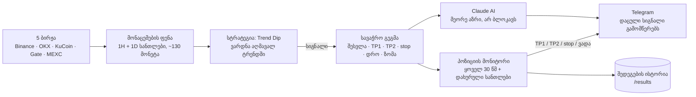

# TradeAlly — არქიტექტურა

## კომპონენტები

| ნაწილი | რას აკეთებს |
|---|---|
| **მონაცემები** | 5 ბირჟიდან, ავტომატური სარეზერვო წყაროებით; მკვდარი/delisted წყვილებს თავად გამორიცხავს |
| **სტრატეგია** | ეძებს მკვეთრ ვარდნას მონეტაზე, რომლის დღიური ტრენდი აღმავალია; ვარდნად ბაზარზე ჩუმდება |
| **გეგმა** | TP1-ზე 50% + stop შესვლის ფასზე → ტრეიდი ზარალზე ვეღარ დაიხურება; TP2-ზე დანარჩენი |
| **Claude AI** | ყოველ სიგნალს აფასებს და 2–3 წინადადებით მეორე აზრს ურთავს |
| **მონიტორი** | ფასს ამოწმებს live-ში და დახურული სანთლების high/low-ით — მოკლე "წვერებიც" ითვლება |
| **Backtest** | იგივე კოდი ისტორიულ მონაცემზე: ვარიანტების შედარება, მონეტების რეიტინგი |
| **Telegram** | სუფთა ჩატი: სიგნალები რჩება, ბრძანებები ქრება; სიგნალების გადაგზავნა დაბლოკილია |

## უსაფრთხოება

- კოდი და პარამეტრები დახურულია; ყველა გასაღები მხოლოდ სერვერის გარემოში ინახება
- ბოტი მუშაობს მხოლოდ პირად ჩატში; ადმინის ბრძანებები მხოლოდ ადმინს ემორჩილება
- მონაცემები მუდმივ საცავშია + ყოველდღიური სარეზერვო ასლი
